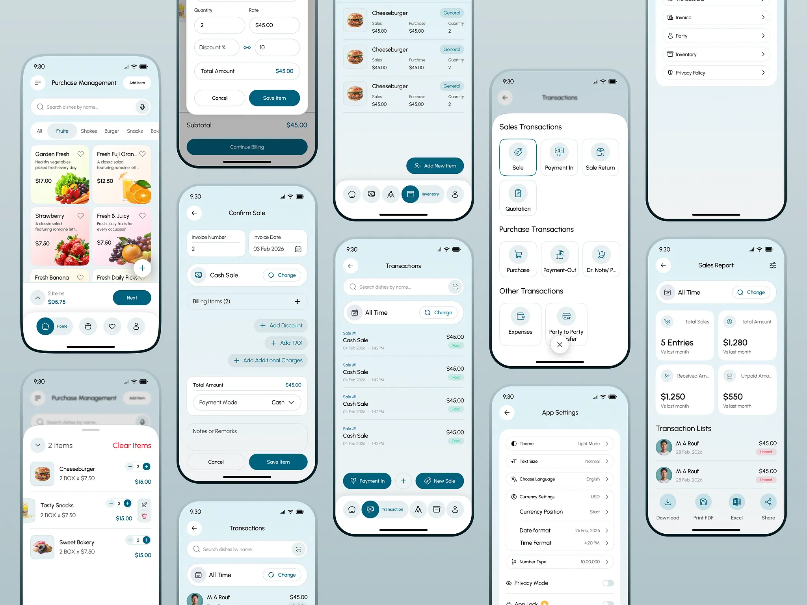
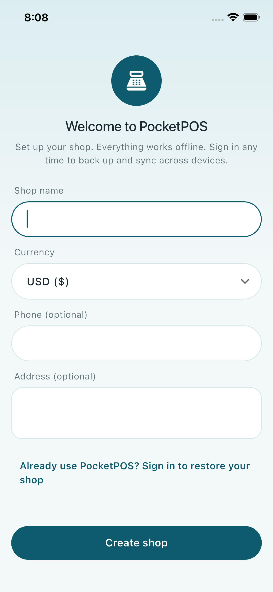
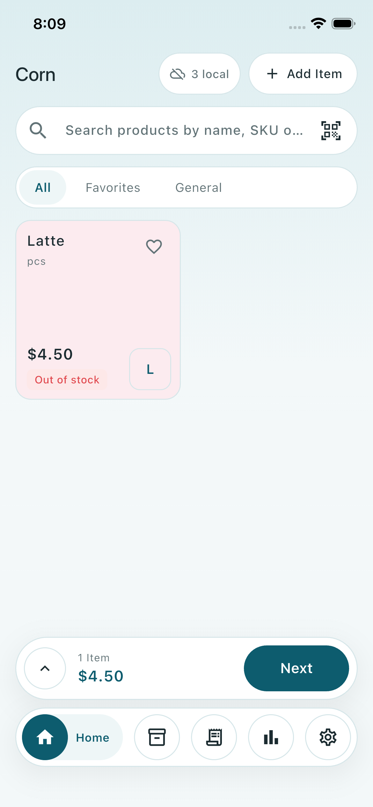
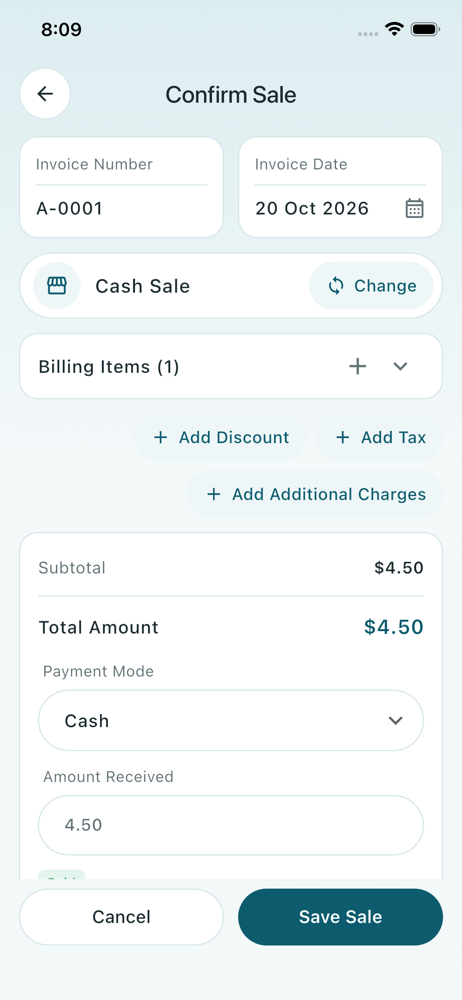
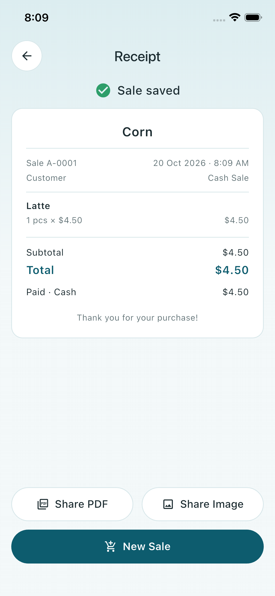
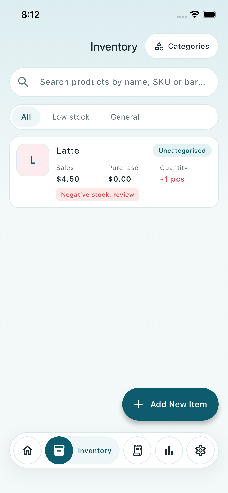
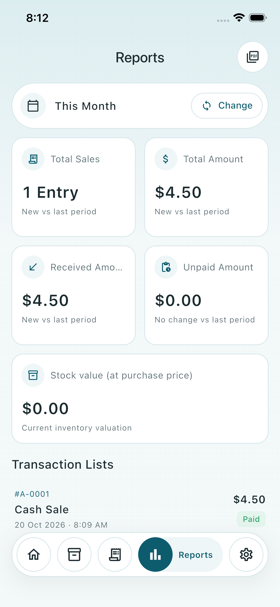

# PocketPOS

**Mobile Point of Sale & Inventory System for small shops and cafés.**
Built with Flutter, SQLite and Firebase.

PocketPOS turns a phone or tablet into a full point-of-sale terminal. You can ring up sales, scan barcodes, send digital receipts and keep stock accurate. It keeps working when the internet drops and syncs everything automatically once you're back online.



---

## 📱 Screenshots

Taken from the app running on the iOS Simulator (iPhone 16e).

| Shop setup | Sell | Confirm Sale |
|:---:|:---:|:---:|
|  |  |  |

| Receipt | Inventory | Reports |
|:---:|:---:|:---:|
|  |  |  |

---

## ✨ Features

### 🛒 Fast checkout
- Product grid with instant **search** and **category filters**
- **Barcode scanning** with the device camera
- Cart with quantity stepper, per-line price and discount edits
- Cart-level discounts, taxes and additional charges
- Multiple payment modes (Cash, Card, Mobile Money, Bank, Credit) with Paid / Partial / Unpaid status
- Walk-in "Cash Sale" or sale to a saved customer

### 🧾 Digital receipts
- Clean receipts with your shop branding
- Share as **PDF / image** via WhatsApp, SMS or email
- Reprint or reshare any past sale
- Bluetooth thermal printing *(planned)*

### 📦 Inventory
- Products with SKU, barcode, unit, sale and purchase price, images and categories
- **Stock updates automatically after every sale**, return and purchase
- Auditable stock movement history and manual adjustments
- Low-stock indicators

### 💸 Transactions and parties
- Sales, Payment In, Sale Returns, Quotations, Purchases, Payment Out, Expenses
- Searchable history with period filters (Today → All Time)
- Customer and supplier balances and ledgers

### 📊 Reports
- KPI dashboard: Total Sales, Total Amount, Received, Unpaid, each compared with last period
- Sales, stock and top-product reports
- Export to **PDF**, **Excel** or share

### 📶 Offline-first sync
- Every action is saved to **local SQLite first**, so the app runs without internet
- Changes queue up and **sync to Firebase automatically** when connectivity returns
- Multi-device support with conflict-safe stock merging

### ⚙️ Settings
- Light / Dark theme, text size, language
- Currency, symbol position, date and number formats
- Privacy Mode and App Lock *(planned)*

---

## 🧱 Tech stack

| Layer | Technology |
|---|---|
| UI | Flutter · Material 3 (custom theme) |
| State | Riverpod |
| Navigation | go_router |
| Local database | SQLite via Drift |
| Cloud | Firebase Auth · Cloud Firestore · Cloud Storage |
| Config | flutter_dotenv |
| Scanning | mobile_scanner |
| Receipts / exports | pdf · printing · excel · share_plus |

---

## 🚀 Getting started

```bash
git clone <repo-url> pocket_pos
cd pocket_pos
flutter pub get
cp .env.example .env      # then fill in your Firebase values
flutter run
```

Firebase keys live in `.env`, which is git-ignored. See **[docs/setup.md](docs/setup.md)** for where to find each value, how to use the emulator, and code generation.

---

## 📁 Project structure

```
lib/
├── main.dart          # loads .env → initializes Firebase → runs the app
├── core/              # config, theme, shared widgets, database, sync, router
└── features/          # auth, sell, inventory, transactions, parties, reports, settings
docs/                  # product and engineering documentation
```

---

## 📚 Documentation

| Doc | What's inside |
|---|---|
| [Features](docs/features.md) | Full feature spec and priorities (source of truth for *what* to build) |
| [Design System](docs/design-system.md) | Colors, typography, components and screen patterns from the design mock |
| [Architecture](docs/architecture.md) | Stack, folder layout, layering rules and key flows |
| [Data Model](docs/data-model.md) | SQLite tables, Firestore layout and conventions |
| [Offline & Sync](docs/offline-sync.md) | Outbox pattern, push/pull, conflict resolution |
| [Setup](docs/setup.md) | Environment, Firebase config via `.env`, emulator, tooling |

---

## 🗺️ Roadmap

- [x] **MVP core:** shop setup, email sign-in, products and categories, barcode scan, sell + cart + checkout, receipts (PDF / image share), automatic stock updates and adjustments, transactions (list, detail, void, Payment In), basic reports, settings, offline sync
- [x] **Product images and shop logo:** camera / gallery, shown on the sell grid, inventory and receipts, uploaded to Cloud Storage when signed in
- [ ] **MVP polish:** bundled brand font, background sync task, full string localization
- [ ] Parties and balances, purchases, returns, quotations, expenses
- [ ] Bluetooth thermal printing, Excel export, roles and permissions
- [ ] App Lock, Privacy Mode, CSV import / export, profit reports

---

## 🔐 Security note

Firebase client config is kept out of source control via `.env`, but client keys still ship inside the app binary. Access control is enforced by **Firestore / Storage Security Rules** and **Firebase App Check**. Never put server-side secrets in the app.

---

## 📄 License

Private project. All rights reserved.
